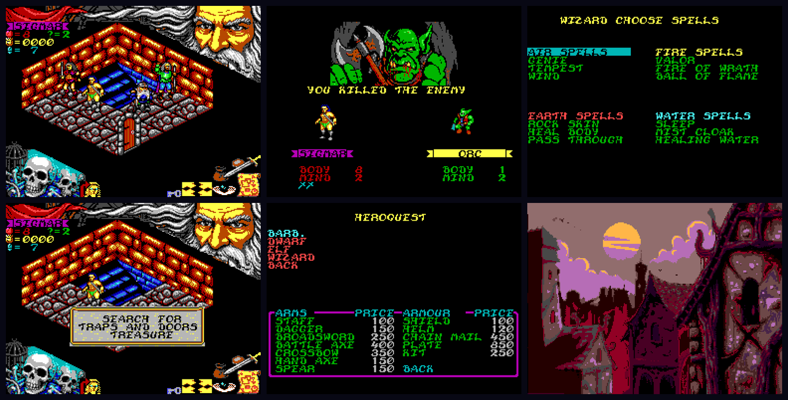

# HeroQuest for MSX2

**Four heroes, twenty-four adventures, and the world of HeroQuest in sixteen colours on MSX2.**

An unofficial homage port by **DiHalt Studio**, 2026.



## Play it

Download the ROM and manuals from [GitHub Releases](https://github.com/nwlg/heroquest-msx2/releases/latest).

Version **1.0** is a **2 MiB ASCII16 MegaROM** for MSX2, MSX2+ and MSX turbo R with **64 KB RAM and 128 KB VRAM**. It uses the computer's own video output and PSG sound. **MoonSound/OPL4** is optional and detected automatically. No additional video cartridge is required.

Choose **ENGLISH** or **ESPAÑOL** after the opening illustration. The introduction, menus, messages and all twenty-four adventures follow that choice until reset. Hero save codes work in either language.

Place the downloaded `heroquest.rom` in `release/`, then use `make run`, `make turbor` or `make opl4`. You can also start openMSX directly:

```sh
openmsx -machine Philips_NMS_8250 -carta release/heroquest.rom -romtype ASCII16
```

Read the complete illustrated manuals: **[English](docs/manual/manual-en.pdf)** · **[Español](docs/manual/manual-es.pdf)**. Each edition contains screenshots in its own language, the rules, hero codes, equipment, adventures and a printable cartridge label.

| Control | Move / choose | Action |
|---|---|---|
| Keyboard | Cursor keys | SPACE |
| MSX joystick, port 1 | Stick | Fire |
| MSX mouse, port 1 or 2 | Move the mouse | Left button |

SPACE, ESC or the right mouse button skips the animated introduction. At the language selector, RETURN also confirms the choice.

Guide the barbarian, dwarf, elf and wizard through Morcar's dungeons. Explore, search for treasure and hidden doors, cast spells, and survive long enough to bring your heroes home.

## What is this?

This adaptation keeps the game logic of Gremlin Graphics' ZX Spectrum 128K HeroQuest and replaces the hardware-facing routines with an MSX2 runtime. Native SCREEN 5 drawing uses the PC version's sixteen-colour artwork; the animated introduction and music come from the Amiga version. The fourteen original adventures are joined by the ten adventures of **Return of the Witch Lord**.

The port adds keyboard, joystick and mouse controls, a choice of Gothic or plain lettering, language selection, and sixteen-letter hero codes for carrying characters between sessions. The DiHalt logo has a PSG fanfare and an OPL4 version. Introduction timing follows a 50 Hz clock on both 50 Hz and 60 Hz displays.

## Building from source

The original commercial game is **not distributed in this repository**. Building the ROM requires your own original game data, supplied separately. The exact input files and preparation steps are documented in **[Building](docs/BUILDING.md)**.

The build uses Python 3, Pillow, GNU Make and sjasm 0.42c. Rebuilding the manuals additionally requires LaTeX or Tectonic. The port's source, editable graphics and translations are included.

```sh
git clone https://github.com/nwlg/heroquest-msx2.git
cd heroquest-msx2
# Prepare your original game inputs as described in docs/BUILDING.md.
make
make release
```

`make` builds the normal ROM. `make cheat-rom` builds an optional edition with invulnerable heroes and guaranteed combat victories. `make manual` rebuilds both PDF manuals, `make release` prepares the download files, and `make help` lists the available targets. Downloaded release ROMs can be played without compiling the source.

## Repository layout

| Path | Contents |
|---|---|
| `src/` | MSX2 runtime, cartridge boot code and patch manifest |
| `assets/` | Editable graphics, palettes, translations and port sound data |
| `tools/` | Builders, converters and development utilities |
| `docs/DESIGN.md` | Runtime, memory, rendering and language architecture |
| `docs/BUILDING.md` | Build dependencies, original inputs and commands |
| `docs/manual/` | English and Spanish manuals, sources and illustrations |
| `release/` | Locally prepared download files; generated binaries are excluded from Git |

## Make it better

**Please improve the game if you feel so!**

Improve the translations, refine the artwork and palettes, make the interface easier to use, or extend the documentation. The editable assets and patch manifest provide starting points without having to replace the original game logic. See [Design](docs/DESIGN.md) for the implementation structure.

## Credits and rights

Original computer game: **Gremlin Graphics Software Limited, 1991**, based on the HeroQuest board game created in collaboration with Games Workshop. MSX2 adaptation: **DiHalt Studio, 2026**.

This is an unofficial port made for study, preservation and homage. It is not affiliated with or endorsed by the original game's rights holders. HeroQuest, its artwork, music and other original material belong to their respective owners. Their inclusion in the port does not transfer those rights. MSX is a trademark of MSX Licensing Corporation.

Development tools include sjasm, Python, Pillow, openMSX, LaTeX/Tectonic and the OPL4 conversion tools under `tools/mod2vgm/`. See the manuals and the tool sources for further credits.
